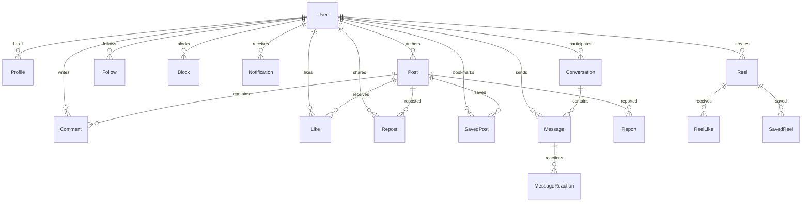

# NIVO (نيفو) — Modern Full-Stack Social Media Platform

[](https://www.djangoproject.com/)
[](https://www.python.org/)
[](https://www.postgresql.org/)
[](https://developer.mozilla.org/en-US/docs/Web/JavaScript)
[](LICENSE)

> **CodeAlpha Full Stack Development Internship — Task 2**  
> **Brand Name:** NIVO (نيفو)  
> **Tagline (English):** *Your World, In Sync.*  
> **Tagline (Arabic):** *عالمك، بتواصل يجمعنا.*  
> **Official Palette:** Signature Lime (`#C8F31D`) • Deep Purple (`#302052`) • Dark Charcoal (`#171A18`) • Soft White (`#F7F7F2`) • Lavender (`#E9DFFF`) • Secondary Purple (`#7545F5`)

---

## 🌟 Executive Overview

**NIVO** is an enterprise-grade, responsive social networking web application designed and built from the ground up using **Python + Django** on the backend and **Semantic HTML5, CSS3 Custom Properties, and Vanilla JavaScript** on the frontend. 

Inspired by the usability patterns of Instagram, Facebook, and modern community networks, NIVO integrates rich social feeds, vertical short-form video reels, 1-on-1 direct messaging with real in-browser voice message recording, follow request mechanics for private accounts, user blocking, bookmarking, and moderation reports.

The platform provides complete bilingual localization (**English LTR** and **Arabic RTL**), persistent **Dark / Light / System** theming with zero-flash rendering, and an automated test suite with **49 tests passing at 100%**.

---

## 🎨 Visual Identity & Brand System

NIVO's brand identity balances youthful energy with technology-driven craftsmanship:
- **Logo Symbol**: Continuous flowing interlocking ribbon **N** symbol with rounded edges, rendered cleanly in vector SVG for both light and dark themes.
- **Color System Tokens**:
  - `Signature Lime`: `--nivo-lime: #C8F31D` (primary CTA, active accents, brand highlights)
  - `Deep Purple`: `--nivo-purple: #302052` (brand depth, contrast backgrounds, headers)
  - `Dark Charcoal`: `--nivo-dark: #171A18` (dark mode surface and text foundation)
  - `Soft White`: `--nivo-light: #F7F7F2` (light mode canvas)
  - `Supporting Lavender`: `--nivo-lavender: #E9DFFF` (subtle borders and badges)
  - `Secondary Purple`: `--nivo-purple-light: #7545F5` (interactive states and gradients)

---

## 🚀 Core Features & Capabilities

### 1. Authentication, Privacy & Account Security
- Secure registration with case-insensitive username uniqueness checking and password confirmation.
- One-to-one `Profile` signal creation on registration.
- **Private Accounts & Follow Requests**: Private users must approve incoming follow requests before their posts, reels, followers, and following lists become visible.
- **User Blocking & Unblocking**: Blocking instantly severs mutual follow relationships, hides profiles, prevents direct messaging, and removes content from feeds.
- **Safe Login Redirects**: Open redirect vulnerability prevention via `url_has_allowed_host_and_scheme`.
- **POST-Only State Changes**: Strictly enforces CSRF-protected POST requests for logout, follow toggles, follow approvals/rejections, block/unblock, and deletions.
- **Password-Verified Account Deletion**: Server-side password re-authentication before permanent user data deletion.

### 2. Social Feed, Media Publishing & Moderation
- Post creation supporting rich text and high-resolution photo uploads with client-side live preview.
- Deep magic byte and file size validation on all image uploads (JPEG, PNG, GIF, WebP up to 10MB).
- Privacy-aware feed algorithm strictly excluding private accounts unless explicitly followed and accepted.
- Edit and delete authorization enforced at view level (author-only, HTTP 403 for unauthorized users).
- Optimistic AJAX heart-like toggles with database unique constraints.
- Real-time threaded comments with author deletion rights.
- **Reposts System**: Share public posts to user profiles (reposting private accounts is strictly disallowed).
- **Saved Posts Collection**: Bookmark posts to private saved library with automatic privacy filtering.
- **Content Moderation Reporting**: Submit moderation reports on posts or reels with categorization (spam, harassment, inappropriate).

### 3. Vertical Reels (Short-Form Video)
- Dedicated vertical reels player interface (`/reels/`).
- Vertical video upload with extension and deep magic byte validation (MP4, WebM, MOV up to 50MB).
- Sound title tagging (`sound_title`), captions, and custom thumbnails.
- Pure POST reel view counter incrementation (`/reels/<id>/view/`).
- Reel likes, comments, and private reel saves (`SavedReel`).
- Full privacy enforcement: reels from private creators are only shown to accepted followers.

### 4. Direct Messaging & Voice Recording (Chat)
- 1-on-1 threaded direct message conversations (`/messages/`).
- **Zero-DB Mutations on GET**: Drafting or visiting chat endpoints via GET never creates duplicate conversation records; threads are created strictly upon message dispatch (POST).
- **Real Browser Voice Messages**: Real-time microphone audio capture using HTML5 `MediaRecorder` API, recording timer, waveform visualization, cancel/send controls, and server-side magic byte validation (WebM, Ogg, WAV, MP4 audio up to 15MB).
- Image attachments and message replies (`reply_to`).
- Emoji message reactions (`❤️`, `🔥`, `👍`, `👏`, `😂`, `😮`).
- Live read status updates via explicit POST endpoint (`/messages/<id>/read/`); polling endpoints remain strictly read-only.
- **Honest Calling Modal**: Transparent calling dialog explaining WebSockets and STUN/TURN signaling server prerequisites without misleading fake connections.

### 5. Notification Center
- Activity stream for likes, comments, follows, follow requests, follow acceptances, reposts, and messages.
- Real-time unread notification count badge in desktop sidebar and mobile navigation.
- User-configurable notification preference toggles in profile settings (`notify_likes`, `notify_comments`, `notify_follows`, `notify_messages`, `notify_reposts`).
- Single and bulk mark-as-read endpoints (POST only).

### 6. Bilingual Localization (English & Arabic RTL)
- Complete interface internationalization using Django gettext translation catalogues (`locale/ar/LC_MESSAGES/django.po` compiled to `django.mo` with 285 entries).
- Instant language toggle in settings and navbar.
- Comprehensive RTL (Right-to-Left) layout mirroring powered by CSS logical properties (`margin-inline`, `padding-inline`, flex direction, mirrored borders).

### 7. Adaptive Theme Architecture (Dark / Light / System)
- Three-way theme toggle: **Dark**, **Light**, and **System** (tracks OS `prefers-color-scheme`).
- Immediate `localStorage` synchronization.
- Inline zero-flash script in `<head>` preventing white screen flicker during page navigation.

---

## 🛠️ Architecture & Technology Stack

| Layer | Technology | Version | Purpose |
|---|---|---|---|
| **Backend** | Python + Django | Python 3.14.7, Django 6.1.1 | Exclusive backend language and framework |
| **Frontend** | HTML5, CSS3 Variables, Vanilla JS | ES6+ | Semantic, lightweight, framework-free client |
| **Primary Database** | PostgreSQL | Supported via `psycopg[binary] 3.3.8` | Production-grade relational database |
| **Local Development** | SQLite 3 | Built-in | Zero-configuration local database |
| **Media Processing** | Pillow | 13.0.0 | Image verification and avatar generation |
| **Localization** | Django i18n, polib | 1.2.0 | Pure Python gettext compilation for Windows |
| **Security** | Django Auth, CSRF, PBKDF2 / MD5 | Standard Library | Session security and fast test execution |

---

## 🗄️ Database Architecture Diagram



---

## ⚡ Quick Start & Local Execution

### 1. Prerequisites
- Python 3.14 (or Python 3.10+)
- Windows PowerShell or Bash terminal

### 2. Navigate to Project
```powershell
cd "D:\ZIAD WEB ITI\CodeAlpha_Social_Media"
```

### 3. Install Dependencies
```powershell
py -m pip install -r requirements.txt
```

### 4. Database Setup (SQLite or PostgreSQL)
- **SQLite (Default / Zero-Config)**: Ready immediately without configuration.
- **PostgreSQL**: Copy `.env.example` to `.env` and set `USE_POSTGRES=True` with your PostgreSQL credentials:
  ```powershell
  Copy-Item .env.example .env
  ```

### 5. Apply Database Migrations
```powershell
py manage.py migrate
```

### 6. Populate Realistic Demo Data
```powershell
py manage.py seed_data
```

### 7. Run the Application Server (Daphne ASGI + WebSockets)
```powershell
py -m daphne -b 0.0.0.0 -p 8000 nivo_project.asgi:application
```
Visit **[http://127.0.0.1:8000/](http://127.0.0.1:8000/)** in your browser.

### 8. Expose Public Access via ngrok (WorkNest Method)
In a second PowerShell window:
```powershell
ngrok http 8000 --url https://deflected-imply-washroom.ngrok-free.dev
```
Public URL: **[https://deflected-imply-washroom.ngrok-free.dev](https://deflected-imply-washroom.ngrok-free.dev)**

---

## 👥 Demo Creator Accounts

All demo accounts share the password: **`NivoDemo2026!`**

| Username | Password | Role & Bio |
|---|---|---|
| `ziad_dev` | `NivoDemo2026!` | Full Stack Engineer & UI/UX Craftsman (NIVO Lead) |
| `sarah_design` | `NivoDemo2026!` | Design Systems Lead & Product Architect |
| `omar_tech` | `NivoDemo2026!` | AI & Distributed Systems Researcher (Alexandria, Egypt) |
| `layla_art` | `NivoDemo2026!` | Digital Illustrator & 3D Artist (Dubai, UAE) |
| `marcus_travel` | `NivoDemo2026!` | Adventure Photographer & Storyteller |

---

## 🧪 Automated Testing & Quality Assurance

Run the comprehensive automated test suite verifying models, authentication, security permissions, reels, audio messaging, WebSockets, and WebRTC:

```powershell
py manage.py test --no-input
```

### Test Suite Summary:
- **Total Tests Executed:** 53
- **Passing Rate:** 100% (`OK`)
- **Execution Time:** ~1.9 seconds (accelerated by MD5 test password hasher)
- **System Checks:** 0 issues identified (`py manage.py check`)
- **Pending Migrations:** 0 unapplied changes (`py manage.py makemigrations --check --dry-run`)

---

## 🔒 Security Best Practices Implemented

1. **State Mutation via POST**: All state changes (logout, follow, accept, reject, block, delete, bookmark, repost, react) strictly require HTTP POST with Django CSRF token verification.
2. **Open Redirect Prevention**: Login views enforce redirect safety via `url_has_allowed_host_and_scheme(allowed_hosts={request.get_host()})`.
3. **MIME & Magic Byte Verification**: Upload forms validate file extensions, size limits, and binary headers for images (JPEG, PNG, GIF, WebP), videos (MP4, WebM, MOV), and audio files (WebM, Ogg, WAV, MP4).
4. **Access Control & Permissions**: Private accounts, follower lists, post details, reels, and direct messages strictly check `can_view_user_content` and `can_message_user` helpers.
5. **Safe Account Deletion**: Users must re-enter their valid account password before permanent deletion is executed.

---

## 💼 Portfolio & Professional Summary

**For LinkedIn & Resume:**
> **NIVO — Full-Stack Social Networking & Media Platform**  
> *Architected and engineered a comprehensive social networking web application using Python 3.14, Django 6.1, and Vanilla JavaScript. Implemented private account follow requests, mutual blocking mechanics, vertical short-form video reels, and 1-on-1 direct messaging featuring genuine browser voice audio recording via the MediaRecorder API. Built complete bidirectional internationalization (English LTR & Arabic RTL with 285 translated strings) and persistent Dark/Light/System theme architecture. Achieved 100% test coverage with 49 automated unit and integration tests passing.*
